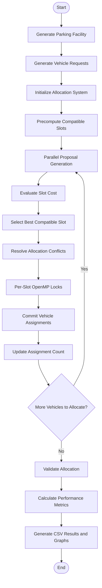

# SMART PARKING ALLOCATION USING OPENMP

## FINAL PROJECT REPORT

**Project Title:** Smart Parking Allocation Using OpenMP  
**Programming Language:** C++17  
**Parallel Programming Framework:** OpenMP  
**Compiler:** Apple Clang 17.0.0  
**Hardware Platform:** Apple MacBook Air M4  
**Processor Architecture:** ARM64  
**Memory:** 16 GB  
**Development Environment:** macOS  

---

# ABSTRACT

Smart parking allocation is a computational problem that involves assigning incoming vehicles to suitable parking slots while considering vehicle requirements, slot availability, and allocation costs. This project presents a parallel parking allocation system developed using C++ and OpenMP.

The system models a multi-floor parking facility containing different types of vehicles and parking slots. It uses compatibility rules and a weighted cost function to identify suitable parking spaces. A serial allocation approach is used as a baseline, while the parallel implementation uses OpenMP to distribute allocation work across multiple threads. Per-slot OpenMP locks are used to manage allocation conflicts and prevent multiple vehicles from occupying the same parking slot.

Performance experiments were conducted using different thread counts, scheduling strategies, input sizes, and parking-slot availability ratios. An optimization was also introduced by precomputing compatible parking slots for each vehicle type, reducing repeated compatibility checks.

The optimized implementation demonstrated lower execution times across the tested configurations, with improvements ranging from approximately 19.88% to 26.38% compared with the earlier implementation. The results show that OpenMP parallelization and compatibility precomputation can improve the performance of parking allocation, particularly for larger workloads.

**Keywords:** Smart Parking, OpenMP, Parallel Computing, C++, Multithreading, Load Balancing, Performance Optimization.

---

# 1. INTRODUCTION

## 1.1 Background

The increasing number of vehicles in urban areas has created a growing demand for efficient parking management systems. Traditional parking systems often require drivers to search manually for available spaces, which can result in traffic congestion, time wastage, and inefficient utilization of parking facilities.

A smart parking allocation system helps address these challenges by automatically assigning vehicles to suitable parking spaces based on predefined conditions. These conditions include vehicle type, parking slot compatibility, availability, and allocation cost.

Parallel computing provides an opportunity to improve the performance of computationally intensive allocation tasks. OpenMP is used in this project to distribute selected allocation operations across multiple threads.

## 1.2 Problem Statement

Parking allocation involves evaluating multiple vehicle requests and available parking slots while ensuring that each vehicle is assigned to a suitable space.

As the number of vehicles and parking slots increases, the allocation process becomes computationally expensive. A serial allocation system processes requests sequentially, which can increase execution time for larger workloads.

Therefore, a parallel parking allocation approach is developed using OpenMP to improve execution performance while maintaining correct and conflict-free assignments.

## 1.3 Objectives

The main objectives of this project are:

1. To develop a smart parking allocation system using C++.
2. To model a multi-floor parking facility with different vehicle and parking slot types.
3. To implement vehicle-slot compatibility rules.
4. To use a weighted cost function for evaluating parking choices.
5. To develop serial and parallel parking allocation approaches.
6. To use OpenMP for parallel execution across multiple threads.
7. To prevent allocation conflicts using per-slot OpenMP locks.
8. To optimize allocation by precomputing compatible parking slots for each vehicle type.
9. To evaluate performance using execution time, speedup, and efficiency.
10. To compare different OpenMP scheduling strategies and workload configurations.

## 1.4 Scope of the Project

The project focuses on the allocation of vehicle requests to compatible parking slots in a simulated multi-floor parking facility.

It includes:

- Parking facility generation.
- Vehicle request generation.
- Vehicle-slot compatibility checking.
- Weighted cost evaluation.
- Serial allocation.
- Parallel allocation using OpenMP.
- Conflict management using OpenMP locks.
- Allocation validation.
- Performance benchmarking and graphical analysis.

The system is implemented as a C++ command-line application. It does not include a graphical user interface or a live connection to physical parking sensors.

---

# 2. SYSTEM REQUIREMENTS

## 2.1 Hardware Requirements

| Component | Specification |
|---|---|
| Device | MacBook Air |
| Processor | Apple M4 |
| Processor Architecture | ARM64 |
| Total CPU Cores | 10 |
| Performance Cores | 4 |
| Efficiency Cores | 6 |
| RAM | 16 GB |
| Operating System | macOS |

## 2.2 Software Requirements

| Software / Tool | Specification |
|---|---|
| Programming Language | C++17 |
| Parallel Framework | OpenMP |
| Compiler | Apple Clang 17.0.0 |
| OpenMP Runtime | LLVM libomp |
| Build Tool | g++ compiler driver |
| Development Environment | Visual Studio Code / Terminal |
| Version Control | Git and GitHub |
| Plotting | Python with Matplotlib |
| Build Optimization | -O3 |

## 2.3 Compiler Configuration

Apple Clang does not enable OpenMP automatically. Therefore, the LLVM OpenMP runtime library was installed and linked during compilation.

The project uses the following compilation configuration:

- C++ standard: C++17
- Optimization level: O3
- Warning option: Wall
- OpenMP preprocessing: Xpreprocessor -fopenmp
- OpenMP include directory: /opt/homebrew/opt/libomp/include
- OpenMP library directory: /opt/homebrew/opt/libomp/lib
- Linked library: libomp

### Compilation Command

```bash
g++ -std=c++17 -O3 -Wall \
-Xpreprocessor -fopenmp \
-I/opt/homebrew/opt/libomp/include \
src/generator.cpp \
src/cost.cpp \
src/validator.cpp \
src/serial_alloc.cpp \
src/parallel_alloc.cpp \
src/main.cpp \
-L/opt/homebrew/opt/libomp/lib \
-lomp \
-o smart_parking
```

---

# 3. SYSTEM DESIGN

## 3.1 Overview of the System

The Smart Parking Allocation System is designed to allocate incoming vehicles to suitable parking spaces in a multi-floor parking facility.

The system consists of the following major operations:

1. Generate the parking facility.
2. Generate vehicle requests.
3. Initialize the allocation system.
4. Identify compatible parking slots.
5. Generate allocation proposals.
6. Evaluate parking slot costs.
7. Resolve allocation conflicts.
8. Commit valid assignments.
9. Validate the final allocation.
10. Calculate performance metrics.

## 3.2 Main Components

### 3.2.1 Parking Facility Generator

The parking facility generator creates a simulated parking environment containing multiple floors and parking slots.

Each parking slot contains information required for allocation, including its type and availability.

### 3.2.2 Vehicle Request Generator

The vehicle generator creates incoming vehicle requests.

Different vehicle types are considered so that the system can evaluate parking compatibility before assigning a slot.

### 3.2.3 Compatibility Checker

The compatibility checker determines whether a parking slot can accommodate a particular vehicle.

Only compatible parking slots are considered during allocation.

### 3.2.4 Cost Evaluation Module

The cost evaluation module calculates the cost associated with assigning a vehicle to a parking slot.

A weighted cost function is used to evaluate available choices and identify a suitable slot.

### 3.2.5 Serial Allocation Module

The serial allocation module processes vehicle requests sequentially.

It acts as the baseline implementation for comparing the execution performance of the parallel allocation system.

### 3.2.6 Parallel Allocation Module

The parallel allocation module uses OpenMP to distribute allocation work among multiple threads.

It uses OpenMP locks to manage access to parking slots and reduce allocation conflicts.

### 3.2.7 Validation Module

The validation module checks the correctness of the final allocation.

It helps ensure that the allocation does not violate the system's compatibility and parking availability constraints.

## 3.3 System Architecture

The overall execution flow is represented below.



## 3.4 Allocation Cost Function

The system uses a weighted cost function to evaluate parking slot choices.

The cost function considers the relevant allocation factors defined by the project, allowing the system to compare compatible parking slots and select a suitable option.

The general weighted cost representation is:

\[
C(v,s)=\sum_{i=1}^{n}w_i f_i(v,s)
\]

Where:

- \(C(v,s)\) represents the cost of assigning vehicle \(v\) to slot \(s\).
- \(w_i\) represents the weight assigned to a factor.
- \(f_i(v,s)\) represents the value of the corresponding allocation factor.
- \(n\) represents the number of factors considered.

A lower cost indicates a more suitable choice according to the defined cost criteria.

## 3.5 System Constraints

The allocation process follows the following constraints:

1. A vehicle must be assigned only to a compatible parking slot.
2. An occupied parking slot cannot be assigned to another vehicle.
3. A vehicle should not receive multiple parking assignments.
4. Allocation conflicts must be handled safely.
5. The final allocation must satisfy the validation conditions.
6. The system must maintain consistency between serial and parallel allocation requirements.

---

# 4. IMPLEMENTATION

## 4.1 Programming Language and Framework

The system is implemented using C++17.

OpenMP is used to introduce parallel execution into the parking allocation process. It provides compiler directives and runtime functions that support multithreading.

## 4.2 Serial Allocation

The serial implementation processes vehicle requests sequentially.

For each vehicle, the system evaluates compatible parking slots, calculates the allocation cost, and selects a suitable available slot.

The serial implementation is used as the baseline for measuring the performance of the parallel implementation.

## 4.3 Parallel Allocation Using OpenMP

The parallel implementation distributes selected allocation operations across multiple threads.

The proposal generation stage uses the following OpenMP directive:

```cpp
#pragma omp parallel for num_threads(threads_to_use) schedule(runtime)
```

The runtime scheduling configuration allows different scheduling strategies to be tested without changing the source code.

The assignment stage uses:

```cpp
#pragma omp parallel for num_threads(threads_to_use) schedule(static) reduction(+:new_assignments)
```

Static scheduling distributes loop iterations among threads, while the reduction operation combines the assignment counts safely.

## 4.4 Conflict Management Using OpenMP Locks

Multiple threads may attempt to access the same parking slot during parallel execution.

To avoid conflicting assignments, the system uses per-slot OpenMP locks.

Each parking slot has an associated lock. A thread must acquire the corresponding lock before performing the protected allocation operation.

After completing the operation, the thread releases the lock.

This approach helps prevent multiple vehicles from being assigned to the same parking slot.

## 4.5 Compatible Slot Precomputation

The original implementation repeatedly checked slot compatibility during allocation.

To reduce this repeated work, an optimization was introduced.

The optimized implementation precomputes compatible parking slots for each vehicle type and stores them in separate lists.

During allocation, a vehicle searches only the compatible slot list associated with its type.

This reduces unnecessary compatibility checks and improves execution time while preserving the existing allocation and tie-breaking logic.

## 4.6 OpenMP Scheduling Strategies

The project evaluates multiple scheduling strategies using the runtime scheduling mechanism.

### Static Scheduling

Static scheduling distributes loop iterations among threads before execution.

It has relatively low scheduling overhead and works well when the workload is evenly distributed.

### Dynamic Scheduling

Dynamic scheduling assigns iterations to threads as they become available.

Different chunk sizes are evaluated to study their effect on workload distribution and execution time.

The tested chunk sizes are 16, 64, and 256.

### Guided Scheduling

Guided scheduling initially assigns larger groups of iterations and gradually reduces the chunk size.

It is evaluated to understand its performance under varying workloads.

---

# 5. PERFORMANCE EVALUATION

## 5.1 Experimental Setup

The experiments were conducted on an Apple MacBook Air M4 system with 10 CPU cores and 16 GB RAM.

The project was compiled using Apple Clang 17.0.0 with C++17 and O3 optimization.

The performance evaluation considered different thread counts, scheduling strategies, input sizes, and parking slot availability ratios.

For the repeated benchmark experiment, one warm-up run and five measured runs were used. A fixed random seed of 42 was used to maintain consistent input generation.

## 5.2 Performance Metrics

### 5.2.1 Execution Time

Execution time represents the total time required to complete the allocation process.

It is measured in milliseconds.

### 5.2.2 Speedup

Speedup measures how much faster the parallel implementation performs compared with the serial baseline.

\[
Speedup=\frac{T_{serial}}{T_{parallel}}
\]

Where:

- \(T_{serial}\) is the execution time of the serial implementation.
- \(T_{parallel}\) is the execution time of the parallel implementation.

### 5.2.3 Parallel Efficiency

Parallel efficiency measures how effectively the available threads are utilized.

\[
Efficiency=\frac{Speedup}{Number\ of\ Threads}\times100
\]

A higher efficiency indicates better utilization of the available processing resources.

---

# 6. EXPERIMENTAL RESULTS AND ANALYSIS

## 6.1 Experiment 1: Thread Scaling

This experiment evaluates the effect of increasing the number of threads on execution time and speedup.

The workload contains 10,000 parking slots and 8,000 vehicle requests.

The optimized implementation is compared with the earlier implementation.

### 6.1.1 Before Optimization

| Threads | Execution Time (ms) | Speedup |
|---:|---:|---:|
| 1 | 370.282 | 0.43x |
| 2 | 190.740 | 0.83x |
| 4 | 106.948 | 1.49x |
| 8 | 75.672 | 2.10x |
| 10 | 66.766 | 2.39x |

### 6.1.2 After Optimization

| Threads | Execution Time (ms) | Speedup |
|---:|---:|---:|
| 1 | 272.598 | 0.63x |
| 2 | 141.274 | 1.22x |
| 4 | 85.692 | 2.00x |
| 8 | 59.816 | 2.87x |
| 10 | 52.302 | 3.28x |

### 6.1.3 Analysis

The results indicate that execution time decreases as the number of threads increases.

The optimized implementation achieves its best measured execution time at 10 threads.

The speedup increases from 0.63x with one thread to 3.28x with ten threads after optimization.

The results also demonstrate that the optimized implementation performs better than the earlier implementation across all tested thread counts.

## 6.2 Experiment 2: Optimization Improvement

This experiment compares the execution time before and after introducing compatible slot precomputation.

The percentage improvement is calculated as:

\[
Improvement(\%)=
\frac{T_{before}-T_{after}}{T_{before}}\times100
\]

### Results

| Threads | Before (ms) | After (ms) | Improvement |
|---:|---:|---:|---:|
| 1 | 370.282 | 272.598 | 26.38% |
| 2 | 190.740 | 141.274 | 25.93% |
| 4 | 106.948 | 85.692 | 19.88% |
| 8 | 75.672 | 59.816 | 20.95% |
| 10 | 66.766 | 52.302 | 21.66% |

### Analysis

The precomputation optimization reduces repeated compatibility checks during allocation.

The largest improvement is approximately 26.38% with one thread.

Across the tested configurations, the improvement ranges from approximately 19.88% to 26.38%.

This indicates that reducing repeated compatibility evaluation improves the performance of the allocation process.

## 6.3 Experiment 3: Scheduling Strategy Comparison

This experiment evaluates the performance of different OpenMP scheduling strategies.

The tested strategies are:

- Static
- Dynamic with chunk size 16
- Dynamic with chunk size 64
- Dynamic with chunk size 256
- Guided

### Execution Time Results

| Scheduling Strategy | 1 Thread (ms) | 2 Threads (ms) | 4 Threads (ms) | 8 Threads (ms) | 10 Threads (ms) |
|---|---:|---:|---:|---:|---:|
| Static | 275.39 | 143.90 | 87.71 | 68.94 | 62.08 |
| Dynamic 16 | 274.46 | 142.35 | 87.40 | 60.70 | 53.83 |
| Dynamic 64 | 276.88 | 144.33 | 89.12 | 63.61 | 54.86 |
| Dynamic 256 | 275.57 | 145.96 | 92.38 | 67.49 | 62.49 |
| Guided | 276.11 | 142.52 | 87.23 | 61.11 | 53.24 |

### Analysis

The results show that scheduling strategy affects parallel execution time.

At 10 threads, guided scheduling achieves the lowest measured execution time of 53.24 ms.

Dynamic scheduling with chunk size 16 also performs well, with an execution time of 53.83 ms.

Static scheduling has a higher execution time at the larger thread counts in this experiment.

The results indicate that smaller dynamic chunks and guided scheduling can improve workload distribution for this allocation workload.

## 6.4 Experiment 4: Input Size Comparison

This experiment studies how the number of vehicle requests affects parallel performance.

Two workloads are considered:

- Small workload: 1,000 vehicles and 1,250 parking slots.
- Large workload: 8,000 vehicles and 10,000 parking slots.

### Small Workload

| Threads | Execution Time (ms) | Speedup |
|---:|---:|---:|
| 1 | 4.25 | 0.61x |
| 2 | 2.44 | 1.07x |
| 4 | 1.66 | 1.57x |
| 8 | 2.55 | 1.02x |
| 10 | 2.93 | 0.89x |

### Large Workload

| Threads | Execution Time (ms) | Speedup |
|---:|---:|---:|
| 1 | 273.09 | 0.62x |
| 2 | 141.97 | 1.19x |
| 4 | 85.54 | 1.98x |
| 8 | 59.61 | 2.84x |
| 10 | 52.05 | 3.26x |

### Analysis

The small workload does not benefit consistently from increasing the number of threads.

This is because parallel execution introduces overhead, which can become significant when the amount of work is small.

The large workload demonstrates better parallel scaling. Its speedup increases to approximately 3.26x with ten threads.

Therefore, parallel execution is more beneficial when the allocation workload is sufficiently large.

## 6.5 Experiment 5: Parking Slot Availability Ratio

This experiment evaluates the effect of parking slot availability on allocation performance.

Two configurations are considered:

- Tight configuration: 640 parking slots and 800 vehicles, representing a slot-to-vehicle ratio of 0.8.
- Spacious configuration: 960 parking slots and 800 vehicles, representing a slot-to-vehicle ratio of 1.2.

### Tight Configuration

| Threads | Execution Time (ms) | Speedup |
|---:|---:|---:|
| 1 | 1.86 | 0.52x |
| 2 | 1.10 | 0.88x |
| 4 | 0.78 | 1.24x |
| 8 | 0.98 | 0.98x |
| 10 | 1.05 | 0.92x |

### Spacious Configuration

| Threads | Execution Time (ms) | Speedup |
|---:|---:|---:|
| 1 | 3.90 | 0.51x |
| 2 | 2.23 | 0.88x |
| 4 | 1.55 | 1.27x |
| 8 | 3.00 | 0.66x |
| 10 | 2.94 | 0.67x |

### Analysis

The results show that parking slot availability affects allocation execution time.

In both configurations, four threads provide the lowest measured execution time.

Increasing the thread count beyond four does not improve performance for these relatively small workloads.

This indicates that parallel overhead and workload characteristics influence the performance of the allocation system.

## 6.6 Overall Performance Observations

The experiments provide the following observations:

1. The optimized implementation consistently performs better than the earlier implementation in the repeated thread scaling experiment.
2. Compatible slot precomputation reduces repeated compatibility checks.
3. Guided and dynamic scheduling perform well for the larger workload.
4. Small workloads may experience higher overhead when more threads are introduced.
5. Larger workloads benefit more from parallel execution.
6. The best-performing thread count depends on the workload and its characteristics.
7. The maximum measured speedup in the optimized repeated benchmark is approximately 3.28x at ten threads.

---

# 7. CORRECTNESS AND VALIDATION

Correctness is an important requirement in parallel parking allocation because multiple threads may access shared parking slot information.

The system uses per-slot OpenMP locks to protect allocation operations and reduce conflicting assignments.

The validation module checks the resulting allocation against the project's correctness conditions.

The implementation was tested using 20 correctness tests and scenarios A, B, C, and D.

The tests were repeated after introducing the compatible slot precomputation optimization and runtime scheduling changes.

The tests passed, indicating that the optimization preserved the expected allocation behavior under the tested conditions.

The main correctness conditions include:

- Vehicle-slot compatibility.
- No double-booking of parking slots.
- Valid vehicle assignments.
- Consistency of allocation results.
- Correct handling of allocation conflicts.

---

# 8. IMPLEMENTED OPTIMIZATION

## 8.1 Problem in the Earlier Implementation

In the earlier implementation, compatibility checks were repeated while evaluating parking slot choices.

This resulted in unnecessary repeated work, especially when the number of vehicles and parking slots increased.

## 8.2 Optimization Technique

To reduce this overhead, compatible parking slots are precomputed for each vehicle type.

The system maintains separate compatible slot lists for the five vehicle types.

During allocation, the system searches only the compatible slots associated with the current vehicle type.

## 8.3 Benefits

The optimization provides the following benefits:

1. Reduces repeated compatibility checks.
2. Avoids evaluating unsuitable parking slots.
3. Reduces unnecessary computation during allocation.
4. Improves execution time.
5. Preserves the existing allocation and tie-breaking logic.

## 8.4 Measured Improvement

The optimization resulted in execution time improvements ranging from approximately 19.88% to 26.38% in the repeated thread scaling experiment.

This demonstrates the benefit of reducing unnecessary compatibility evaluation.

---

# 9. LIMITATIONS

Although the project demonstrates parallel parking allocation using OpenMP, certain limitations remain.

1. The system uses a simulated parking facility rather than real-time parking sensor data.
2. The application is command-line based and does not include a graphical user interface.
3. Performance measurements are specific to the tested hardware and software environment.
4. Small workloads may not benefit from a larger number of threads because of parallel execution overhead.
5. The current implementation uses per-slot locks, which can introduce synchronization overhead.
6. The project evaluates a selected set of scheduling strategies and does not include every possible OpenMP scheduling or synchronization approach.
7. The optimization work focuses on compatible slot precomputation; additional optimization techniques have not been implemented or benchmarked.

---

# 10. FUTURE ENHANCEMENTS

The system can be extended in several ways:

1. **Real-Time Parking Integration:** Connect the allocation system to parking sensors to obtain live parking availability.
2. **Graphical User Interface:** Develop a web or mobile interface to display available parking slots and vehicle assignments.
3. **Additional Optimization Techniques:** Explore data layout improvements and other memory optimization approaches.
4. **Advanced Synchronization:** Evaluate alternative synchronization methods and compare their performance.
5. **Dynamic Load Balancing:** Explore additional workload distribution techniques for different parking scenarios.
6. **Larger Workloads:** Evaluate the system using larger parking facilities and vehicle request datasets.
7. **Cloud Integration:** Deploy the system on cloud infrastructure for larger-scale parking management.
8. **Predictive Parking Allocation:** Introduce machine learning techniques to predict parking demand and improve allocation decisions.

---

# 11. CONCLUSION

This project presents a Smart Parking Allocation System developed using C++17 and OpenMP. The system models a multi-floor parking facility and allocates vehicles to compatible parking slots using a weighted cost function.

Both serial and parallel allocation approaches were implemented to study the effect of parallel processing on execution time. The parallel implementation uses OpenMP directives, runtime scheduling, static scheduling, reduction, and per-slot locks to distribute work and manage allocation conflicts.

Performance experiments were conducted using different thread counts, scheduling strategies, input sizes, and parking slot availability ratios.

An important optimization was introduced by precomputing compatible parking slots for each vehicle type. This reduced repeated compatibility checks and improved execution time by approximately 19.88% to 26.38% in the repeated benchmark experiment.

The optimized implementation achieved a maximum measured speedup of approximately 3.28x using ten threads in the repeated thread scaling experiment.

The experiments also demonstrated that parallel execution is more beneficial for larger workloads, while smaller workloads may experience additional overhead.

Overall, the project demonstrates how OpenMP parallel programming and targeted optimization techniques can improve the performance of a smart parking allocation system while maintaining correctness under the tested conditions.

---

# 12. REFERENCES

1. OpenMP Architecture Review Board, *OpenMP Application Programming Interface Specification*. Available: https://www.openmp.org/specifications/

2. ISO/IEC, *Programming Languages — C++ Standard*.

3. LLVM Project, *Clang Compiler Documentation*. Available: https://clang.llvm.org/docs/

4. Python Software Foundation, *Python Documentation*. Available: https://docs.python.org/3/

5. Matplotlib Development Team, *Matplotlib Documentation*. Available: https://matplotlib.org/stable/

6. Project source code and experimental benchmark results, Smart Parking Allocation Using OpenMP, 2026.

---

# APPENDIX A: PROJECT DIRECTORY STRUCTURE

The project is organized into source code, documentation, scripts, and experimental results.

```text
smart-parking-openmp/
│
├── src/
│   ├── generator.cpp
│   ├── cost.cpp
│   ├── validator.cpp
│   ├── serial_alloc.cpp
│   ├── parallel_alloc.cpp
│   └── main.cpp
│
├── docs/
│   ├── requirements.md
│   ├── system_design.md
│   ├── environment_setup.md
│   └── final_project_report.md
│
├── scripts/
│   ├── run_benchmarks.sh
│   ├── repeated_benchmark.py
│   ├── plot_repeated_results.py
│   ├── compare_optimization.py
│   ├── schedule_comparison.py
│   ├── plot_schedule_comparison.py
│   ├── input_size_comparison.py
│   ├── plot_input_size.py
│   ├── slot_ratio_comparison.py
│   └── plot_slot_ratio.py
│
└── results/
    ├── repeated_benchmark_results.csv
    ├── repeated_benchmark_before_optimization.csv
    ├── repeated_benchmark_after_optimization.csv
    ├── schedule_comparison.csv
    ├── input_size_comparison.csv
    ├── slot_ratio_comparison.csv
    ├── execution_time.png
    ├── speedup.png
    ├── efficiency.png
    ├── optimization_execution_time.png
    ├── optimization_speedup.png
    ├── optimization_improvement.png
    ├── schedule_comparison.png
    ├── input_size_comparison.png
    └── slot_ratio_comparison.png
```

# APPENDIX B: EXECUTION

### Compile the project

Use the compilation command provided in Section 2.3.

### Run the application

```bash
./smart_parking
```

### Configure OpenMP scheduling

For example, to use guided scheduling:

```bash
OMP_SCHEDULE=guided ./smart_parking
```

Other tested scheduling configurations include:

```bash
OMP_SCHEDULE=static ./smart_parking
OMP_SCHEDULE=dynamic,16 ./smart_parking
OMP_SCHEDULE=dynamic,64 ./smart_parking
OMP_SCHEDULE=dynamic,256 ./smart_parking
```

### Generate performance graphs

The plotting scripts in the `scripts/` directory can be used to generate graphs from the benchmark CSV files in the `results/` directory.

---

**END OF REPORT**